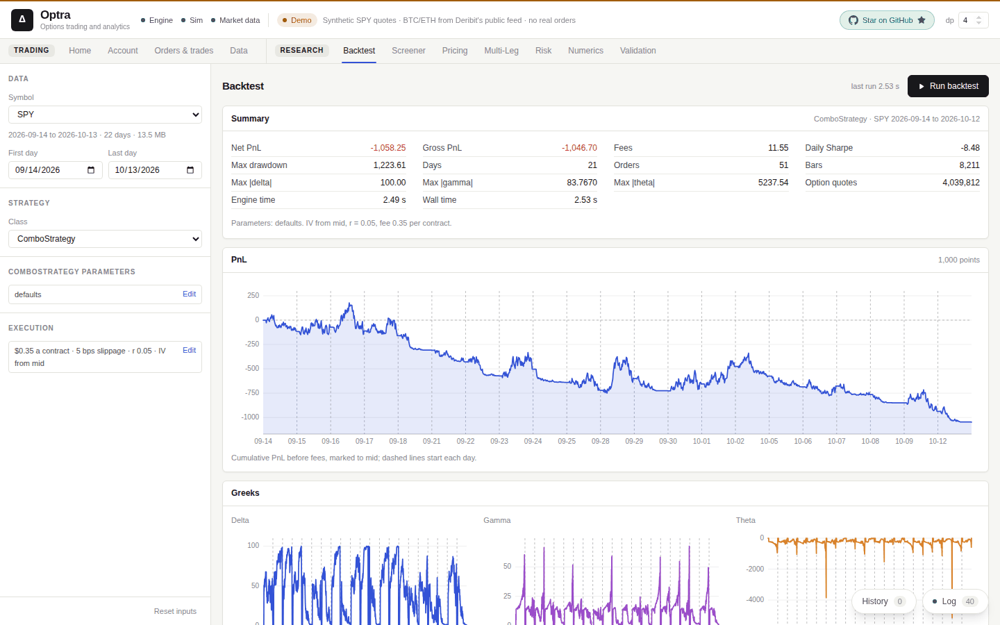
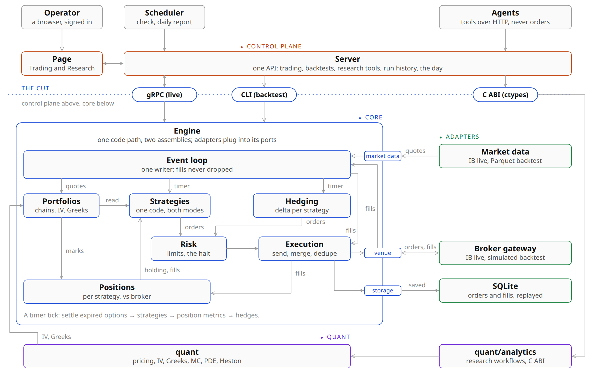

<div align="center">

# Optra

**An options trading system: research a strategy, backtest it, then trade it live.**

C++23 engine · Python server · web app for trading and research

[](#quick-start)
[](#trade-it-live)
[](#license)

[Live demo](https://dufanyin.dev/optra-demo/) · [Architecture](https://dufanyin.dev/quant-option/architecture.html) · [Documentation](#documentation) · [中文](doc/README.zh.md)

</div>

<p align="center"></p>

Optra is built for options. Option chains by expiry, implied volatility and Greeks, multi-leg combos and settlement at expiry are part of the engine, not added on top.

It covers the whole life of a strategy. You study an idea with the research tools, write it as a strategy, backtest it on recorded option days, and then trade it on an Interactive Brokers account. The strategy code is the same at every step.

## Research options

The research tools are for understanding a trade before committing to it.

- **Pricing**: one option priced by Black-Scholes, Monte Carlo and binomial and trinomial trees side by side, with the Greeks and the differences between methods; American options also by finite differences and Longstaff-Schwartz.
- **Volatility**: implied volatility, Heston calibration to a chain, Greek surfaces.
- **Multi-leg**: any combination of legs, recognised (straddle, iron condor, ...) and priced as a whole.
- **Risk**: stress scenarios with each P&L explained by spot, volatility and rate, and hedging schemes compared on simulated paths.
- **Screener**: searches an option chain for combinations worth a look and ranks them by edge against a model volatility.
- **Checks**: the numerical methods tested against theory, optionally before every computation.

Live BTC and ETH option chains come from Deribit's public feed; the screener also reads your own backtest days. Every research tool is an HTTP endpoint with a described schema, so an AI agent can run the same research.

<p align="center"></p>

## Backtest it

A backtest replays recorded option days minute by minute. The strategy sees each minute's full chain, its orders fill at the ask or the bid with fees and slippage, and options held into their expiry are settled at the close.

Each run reports the P&L day by day and splits it into delta, gamma, theta and vega, so you can see where the money came from. Every day runs on its own engine, several days at once, and the same inputs always give the same result.

No market data ships with the repository. You can convert Databento downloads (SPXW and SPY options), replay the quotes the live engine recorded, or generate synthetic days from a model whose answers are known.

## Write your own strategies

A strategy is a C++ class with a few callbacks. It reads the chains and its own holdings, and sends orders through helpers for single options, standard combos and custom legs.

```cpp
class MyStraddle final : public OptionStrategyTemplate {
  public:
    MyStraddle(StrategyContext* context, const std::string& name, const std::string& portfolio,
               const std::unordered_map<std::string, double>& setting);
    static std::span<const StrategyParam> parameters();  // shown and set in the web app

    void on_init_logic() override;   // choose the chains to trade
    void on_timer_logic() override;  // every bar: read quotes and Greeks, place orders
    void on_stop_logic() override;   // close what is left
};
REGISTER_STRATEGY(MyStraddle);
```

Once registered, it can be backtested and traded from the web app, with its parameters filled in there. Built-in delta hedging can be switched on with one call.

Simple combos need no code: `ComboStrategy` takes the legs as rules (call or put, ratio, strike as a percent from the forward, days to expiry), with entry and exit times, take-profit, stop-loss and an optional hedge. The repository includes nine strategies, ComboStrategy among them; they are examples, not proven edges.

## Trade it live

The same strategy, unchanged, trades on an Interactive Brokers account through the TWS API.

- Every order passes a pre-trade risk check, and one button halts all trading.
- A restart picks up where it stopped, and the holdings are checked against the broker before any strategy starts.
- A health check runs every five minutes, and a report after the close compares the day's fills with a backtest of the same day.

So far Optra trades a paper account. The engine trades only the one account it is given and refuses a live account unless the machine's administrator allows it.

## Try it

The [live demo](https://dufanyin.dev/optra-demo/) runs the real engine on a simulated account: synthetic SPY option days replayed as the market, three example strategies trading, and the research tools open to use.

### Quick start

Linux with GCC 14 or newer (Ubuntu 26.04 is the reference):

```bash
sudo apt install g++ cmake make libarrow-dev libparquet-dev libprotobuf-dev protobuf-compiler libgrpc++-dev \
  protobuf-compiler-grpc libabsl-dev nlohmann-json3-dev libsqlite3-dev libgtest-dev 7zip

./build.sh r                     # the engine into engine/build

# a week of synthetic SPY option days
uv run --project app/server python scripts/data/synthetic_to_parquet.py \
  --start 2025-03-03 --end 2025-03-07 --out data --symbol SPY

# a straddle each day, its P&L split by Greek
./engine/build/entry_backtest --files data/SPY/SPY-2025-03/*.parquet ComboStrategy \
  leg1_ratio=1 leg2_ratio=1 leg2_right=1

./scripts/dev.sh                 # the server and the web app at http://localhost:5173
```

`entry_backtest --list-strategies` lists every strategy and its parameters. A backtest needs no network and no database.

## How it is built

<p align="center">
<picture>
  <source media="(prefers-color-scheme: dark)" srcset="doc/images/architecture-dark.png">
  
</picture>
</p>

The engine is one C++ program. A backtest and live trading run the same engine with different connections plugged in: recorded days and a simulated venue in one, Interactive Brokers in the other. The web app and its server only ask the engine over gRPC; they never touch its state.

Bookings are deterministic: one thread owns all trading state, and a position never depends on the order in which the broker reports its fills. The [architecture](doc/architecture.md) explains the design, and the [interactive diagram](https://dufanyin.dev/quant-option/architecture.html) describes each part when you click it.

## Documentation

- [How Optra fits together](doc/architecture.md): the programs, why they are separate, a quote's path through the engine, from an idea to the paper account
- [The engine](doc/engine.md): events and bookings, the live process, restarts and expiry, backtests, a simulated market, what IB sends back, building and testing
- [The server and the web app](doc/server.md): what the server does, the views, running it day to day, the public demo
- [Research](doc/research.md): the research views, the methods, market data, tools for agents
- [Backtest data](doc/data.md): the format, converting Databento downloads, replaying paper days, synthetic days
- For coding agents: [AGENTS.md](AGENTS.md)

## Project status

About 13,000 lines of core C++ and 154 GoogleTest cases, including concurrency, shutdown and IB paper-account integration tests, with ASan and TSan runs. Trading is on a paper account only. Next: longer multi-day backtests, stocks, and lower latency. The [`python-mvp`](../../tree/python-mvp) branch keeps the original Python implementation the C++ system grew out of.

## License

For learning and portfolio use ([LICENSE](LICENSE)). No commercial use, redistribution or production integration without written permission. Trading carries substantial risk; connecting a live account is at your own risk.
