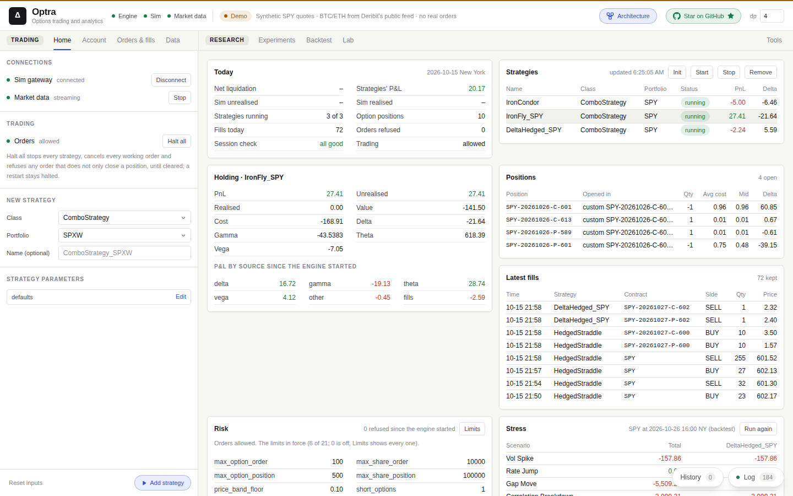
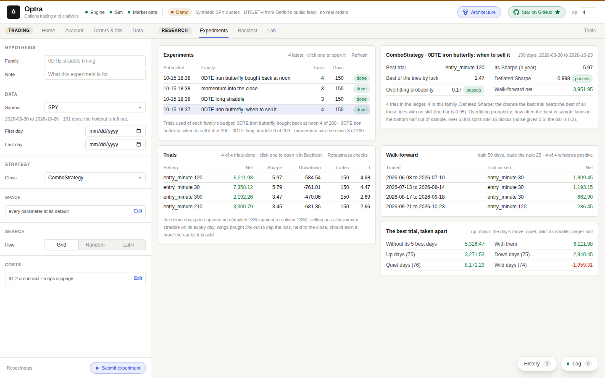
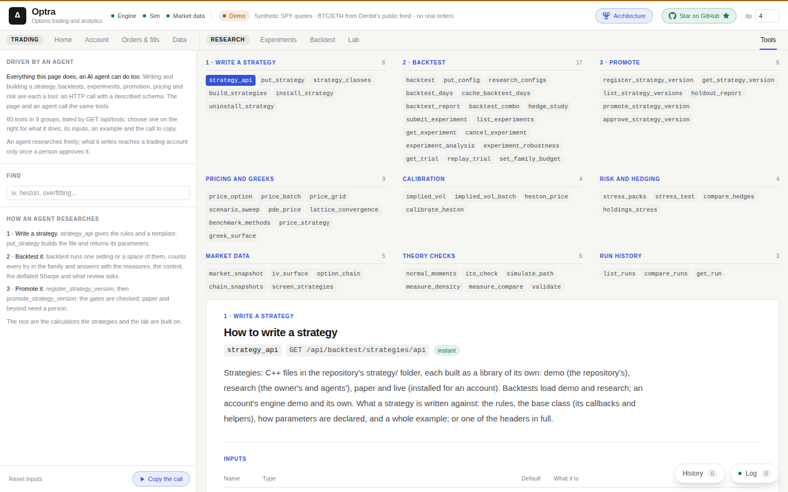

<div align="center">

# Optra

**An options trading system: research a strategy, backtest it, then trade it live.**

C++23 engine · Python server · web app for trading and research

[](#quick-start)
[](#trade-on-interactive-brokers)
[](#license)

[Live demo](https://dufanyin.dev/optra-demo/) · [Architecture](https://dufanyin.dev/optra-architecture/) · [Documentation](#documentation) · [中文](doc/README.zh.md)

</div>

<p align="center"></p>

Optra's engine works in options: chains organised by expiry, implied volatility and Greeks worked out as the quotes come, a multi-leg combo sent as one order, options held to expiry settled at the close on their own. It covers the whole life of a strategy: you study an idea with the research tools, write it as a strategy, backtest it, and trade it. The strategy code is the same at every step.

Cloned and built, the whole system runs on a simulated market: no broker account, no data subscription, no outside service to connect to. To look before installing anything, open the **[live demo](https://dufanyin.dev/optra-demo/)**: the same system on a simulated account, strategies trading and the research tools open to use.

## Quick start

Linux with GCC 14 or newer (Ubuntu 26.04 is the reference), [uv](https://docs.astral.sh/uv/) for Python and Node.js for the page:

```bash
sudo apt install g++ cmake make libarrow-dev libparquet-dev libprotobuf-dev protobuf-compiler libgrpc++-dev \
  protobuf-compiler-grpc libabsl-dev nlohmann-json3-dev libsqlite3-dev libgtest-dev 7zip nodejs npm
curl -LsSf https://astral.sh/uv/install.sh | sh

git clone https://github.com/DuFanYin/optra.git && cd optra
./build.sh r              # the engine, the backtester and the strategies, into engine/build
./scripts/dev.sh sim      # the whole system on a simulated market
```

Open http://localhost:5173. The first start writes synthetic SPY option days into `data/SPY`: the three months before today for backtests, and today's (or the next weekday's, at a weekend) for the market. Then it starts four processes:

- the **engine** on a simulated market (`entry_simulate`): today's synthetic day replayed minute by minute from its open, at the wall clock's pace, with orders filled at its quotes. It is the live engine, with a simulated exchange plugged in where Interactive Brokers would be;
- the **server**: everything the page does goes through it, and it asks and commands the engine over gRPC;
- a **research worker**, which runs the backtests and experiments the server queues;
- the **page**.

Ctrl+C stops them all. The simulated account (its strategies, holdings and fills) is kept in `data/sim/` and is still there after a restart; the market replays the day again from its open.

## What to try

**Trade.** On Home, pick a strategy class and the SPY portfolio under *New strategy*, set its parameters and press *Add strategy*, then *Init* and *Start*. `ComboStrategy` with its defaults buys an at-the-money call; a second leg on the put makes it a straddle, and selling both while buying wings 2% out makes an iron butterfly. Its holding, positions and fills update as the day replays; *Halt all* stops every strategy and cancels every working order; *Limits* shows the pre-trade risk checks every order passes.

**Backtest.** On Backtest, choose a strategy, its setting and a range of days, and press *Run backtest*. Each day runs on its own engine, minute by minute: the strategy sees the full chain, its orders fill at the ask or the bid (or wherever in the spread you set: inside it for combos, beyond it for slippage) with fees, options held to expiry are settled at the close. The P&L comes day by day and split into delta, gamma, theta and vega, so you can see where the money came from.

<p align="center"></p>

The same from the command line, with no server, network or database:

```bash
./engine/build/entry_backtest --list-strategies          # every strategy and its parameters
./engine/build/entry_backtest --files data/SPY/SPY-*/*.parquet ComboStrategy leg1_ratio=1 leg2_ratio=1 leg2_right=1
```

**Experiment.** On Experiments, run a strategy over a space of its settings. Every try is registered before it runs and counted in its family (every try made on the same question), so the more you try, the better the best has to be to count: the deflated Sharpe ratio, the probability of backtest overfitting and a walk-forward judge it against all of them.

<p align="center"></p>

**Study a trade.** The Lab holds the calculators:

- **Pricing**: one option by Black-Scholes, Monte Carlo and binomial and trinomial trees side by side, with all five Greeks and the differences between methods, American options also by finite differences and Longstaff-Schwartz; Black-Scholes and Heston calibrated to the market, and the implied-volatility surface.
- **Multi-Leg**: any combination of legs (straddles, spreads, iron condors or your own), priced leg by leg, with the net Greeks.
- **Risk**: an option or a portfolio put through a library of market shocks, to see where the losses come from; four ways of delta-hedging compared on the same simulated paths, hedging cost against tail risk.
- **Screener**: builds single options, straddles, strangles, iron condors and calendars from an option chain and ranks them by edge against a model volatility; the chain can be any minute of your days, or the live BTC and ETH chains from Deribit's public feed.
- **Numerics**, **Validation**: the numerical methods against each other (finite differences, how the trees converge) and against theory, each held to a threshold.

**Let an agent drive it.** Tools lists every tool an agent can call, in the order of the research flow: write a strategy, backtest it, run an experiment, promote a version. Each is an HTTP endpoint with a described schema. What approves, installs or changes what trades stays with a person.

<p align="center"></p>

## Write your own strategy

A strategy is a C++ class with a few callbacks, left with its idea: when to trade, what, and how much. The base class does the rest: the trading day and the minute of it, choosing a chain and the option some strikes from the money, its holdings, and orders for single options, standard combos and custom legs.

```cpp
class MyStraddle final : public Strategy {
  public:
    struct Setting {  // shown and set in the web app, varied by experiments
        Param<int> min_dte{"min_dte", 0, 0, 30};
        Param<double> take_profit{"take_profit", 0.5, 0.0, 5.0};
    };
    using Strategy::Strategy;

    void on_day() override;    // each trading day: choose its chain (select_chain)
    void on_timer() override;  // every bar: read quotes and Greeks, place orders
    void on_stop() override;   // close what is left

  private:
    const Setting setting_ = read_setting<Setting>();  // setting_.min_dte, typed
};
REGISTER_STRATEGY(MyStraddle);
```

Put it in `strategy/research/` and build it with `./build.sh s`: each file is a library of its own, picked up without rebuilding the engine or restarting anything. Or paste the whole file under *Your own strategy* in Home's sidebar and press *Build*: the compiler's errors show as they are, and once it builds, *Install for paper* puts it under *New strategy*. Backtests and experiments load it at once; an engine that trades loads it only once it is installed for its account (`strategy/paper`, `strategy/live`), which is a person's step, so code written by an agent reaches an account only through a person. Built-in delta hedging can be switched on with one call.

Simple combos need no code: `ComboStrategy` takes the legs as rules (call or put, ratio, strike as a percent from the forward, days to expiry), with entry and exit times, take-profit, stop-loss and an optional hedge. `strategy/demo` holds the repository's own strategies: ComboStrategy, the RandomBuyStrategy control every strategy is measured against, a delta-hedged straddle, an IV mean-reversion strategy and two the tests drive; they are not proven edges.

## Your own data

The backtester reads one shape of day file: one Parquet file per underlying and trading day, each row an option's best bid and ask at one moment with the underlying's joined on. Optra is bound to no data vendor; any vendor's data is converted into that shape offline. [doc/data.md](doc/data.md) describes the format, and `scripts/data/example_to_parquet.py` is a small conversion to start from, for quotes that come as two CSV files.

## Trade on Interactive Brokers

The same engine and the same strategies trade an Interactive Brokers account through the TWS API. Build it with the IB gateway, run IB Gateway or TWS, put `IB_ACCOUNT=DU...` (a paper account) in `.env`, and start the stack without `sim`:

```bash
./build.sh r g            # with the IB gateway (the first time fetches the TWS API)
./scripts/dev.sh          # entry_live: market data and orders through IB
```

- Every order passes a pre-trade risk check, and one button halts all trading.
- A restart picks up where it stopped, and the holdings are checked against the broker before any strategy starts.
- Deployed for daily use ([doc/server.md](doc/server.md)), a health check runs every five minutes, and a report after the close compares the day's fills with a backtest of the same day, fill by fill.

So far Optra trades a paper account. The engine trades only the one account it is given and refuses a live account unless the machine's administrator allows it.

## How it is built

The **[interactive architecture diagram](https://dufanyin.dev/optra-architecture/)** shows every part of Optra and what it does when you click it.

The engine is one C++ program. A backtest, the simulated market and live trading run the same engine with different connections plugged in: recorded days and a simulated venue, a replayed day and a simulated exchange, or Interactive Brokers. The web app and its server only ask the engine over gRPC; they never touch its state.

Bookings are deterministic: one thread owns all trading state, and a position never depends on the order in which the broker reports its fills. The [architecture](doc/architecture.md) explains the design.

## Documentation

- [How Optra fits together](doc/architecture.md): the programs, why they are separate, a quote's path through the engine, from an idea to the paper account
- [The engine](doc/engine.md): events and bookings, the live process, restarts and expiry, backtests, a simulated market, what IB sends back, building and testing
- [Latency](doc/latency.md): the engine's internal latency, measured on a named machine: the threads, hand-offs without locks or copies, pricing only what changed
- [The server and the web app](doc/server.md): what the server does, the views, running it day to day, the public demo
- [Research](doc/research.md): the research views, the methods, market data, tools for agents
- [Backtest data](doc/data.md): the format, converting a vendor's data into it, replaying paper days, synthetic days
- [Efficient option strategy backtesting](doc/backtesting.md): a short article: three tiers of storage, a day read and priced once for every trial, results summed once, and what measuring changed
- For coding agents: [AGENTS.md](AGENTS.md)

## Project status

About 18,500 lines of core C++ and 338 tests (GoogleTest, including concurrency, shutdown and IB paper-account integration tests, with ASan and TSan runs), and the server's own. Trading is on a paper account only. Next: longer multi-day backtests, stocks, and lower latency. The [`python-mvp`](../../tree/python-mvp) branch keeps the original Python implementation the C++ system grew out of.

## License

For learning and portfolio use ([LICENSE](LICENSE)). No commercial use, redistribution or production integration without written permission. Trading carries substantial risk; connecting a live account is at your own risk.
