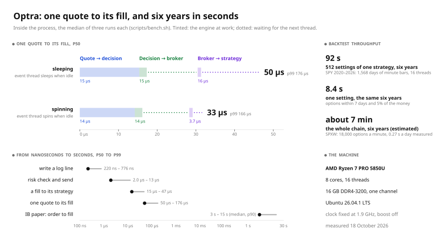

<div align="center">

# Optra

**An options trading system: research a strategy, backtest it, then trade it live.**

[](#quick-start)
[](#trade-on-interactive-brokers)
[](#license)

[Live demo](https://dufanyin.dev/optra-demo/) · [Architecture](https://dufanyin.dev/optra-architecture/) · [Documentation](#architecture-and-documentation) · [中文](doc/README.zh.md)

</div>

Optra is built around the option chain. It works out implied volatility and Greeks as the quotes come, sends a multi-leg combo as one order, and settles options held to expiry at the close.

It covers a strategy's whole life: study an idea with the research tools, write it as a strategy, backtest it, then trade it. The same strategy code runs at every step.

It runs out of the box on a simulated market, with no broker account and no data subscription. To look before installing, open the **[live demo](https://dufanyin.dev/optra-demo/)**: the same system on a simulated account.

<p align="center"></p>

## Quick start

**Docker**

```bash
git clone https://github.com/DuFanYin/optra.git && cd optra
docker compose up --build
```

**Ubuntu 26.04**

```bash
sudo apt install g++ cmake make ccache lld libarrow-dev libparquet-dev libprotobuf-dev protobuf-compiler \
  libgrpc++-dev protobuf-compiler-grpc libabsl-dev nlohmann-json3-dev libsqlite3-dev libgtest-dev 7zip nodejs npm
curl -LsSf https://astral.sh/uv/install.sh | sh

git clone https://github.com/DuFanYin/optra.git && cd optra
./build.sh r              # the engine, the backtester and the strategies, into engine/build
./scripts/dev.sh sim      # the whole system on a simulated market
```

Open http://localhost:5173. The first start writes three months of synthetic SPY option days into `data/backtest/SPY` for backtests, and today's day for the market. Then it starts four processes:

- the **engine** (`entry_simulate`): the live engine with a simulated exchange in place of Interactive Brokers, replaying today's synthetic day at the wall clock's pace;
- the **server**, which the page talks to; it commands the engine over gRPC;
- a **research worker**, which runs the queued backtests and experiments;
- the **page**.

Ctrl+C stops them all. The simulated account is kept in `data/sim/` across restarts.

## What to try

**Trade.** On Home, under *New strategy*, pick a strategy class and the SPY portfolio and set its parameters. Then press *Add strategy*, *Init* and *Start*. `ComboStrategy` with its defaults buys an at-the-money call; a put leg makes it a straddle. Its holding and fills update as the day replays. *Halt all* stops everything, and *Limits* shows the risk checks every order passes.

**Backtest.** On Backtest, choose a strategy, its setting and a range of days, and press *Run backtest*. The strategy runs minute by minute through the days, its holdings carried over. Orders fill at the bid or ask, or wherever in the spread you set, with fees. Options held to expiry settle at the close. The P&L comes day by day, split into delta, gamma, theta and vega.

<p align="center"></p>

The same from the command line, with no server or database:

```bash
./engine/build/entry_backtest --list-strategies          # every strategy, its parameters and their ranges
./engine/build/entry_backtest --files data/backtest/SPY/SPY-*/*.parquet ComboStrategy leg1_ratio=1 leg2_ratio=1 leg2_right=1
```

It prints each day's P&L, the round trips and where the money came from, at IBKR's fees. `--json` gives every column.

**Experiment.** On Experiments, run a strategy over a space of settings. Every try is registered before it runs and counted with the others on the same question. So the more you try, the better the best has to be: the deflated Sharpe ratio, the probability of backtest overfitting and a walk-forward judge it against all of them.

<p align="center"></p>

**Study a trade.** The Lab has the calculators: an option priced by several methods with all its Greeks, multi-leg combos, stress tests, hedging compared, and a screener that ranks structures on any minute of your days. [doc/research.md](doc/research.md) lists them all.

**Let an agent drive it.** Tools lists every tool an agent can call, in the order of the research flow. Each is an HTTP endpoint with a schema. Approving, installing or changing what trades stays with a person.

## Write your own strategy

A strategy is a C++ class with a few callbacks. It holds only its idea: when to trade, what, and how much. The base class does the rest: the trading day, choosing a chain and strikes, holdings, and orders for single options and combos.

```cpp
class MyStraddle final : public Strategy {
  public:
    struct Setting {  // shown and set in the web app, varied by experiments
        Param<int> min_dte{"min_dte", 0, 0, 30};
        Param<double> take_profit{"take_profit", 0.5, 0.0, 5.0};
    };
    using Strategy::Strategy;

    void on_day() override;    // each trading day: choose its chain (select_chain)
    void on_timer() override;  // every bar: read quotes and Greeks, place orders
    void on_stop() override;   // close what is left

  private:
    const Setting setting_ = read_setting<Setting>();  // setting_.min_dte, typed
};
REGISTER_STRATEGY(MyStraddle);
```

Put it in `strategy/research/` and run `./build.sh s`. Each file builds into a library of its own, picked up without rebuilding the engine or restarting anything. You can also paste it under *Your own strategy* in Home's sidebar and press *Build*.

Backtests load a new strategy at once. An engine that trades loads it only after a person installs it for that account (*Install for paper*), so code an agent wrote reaches an account only through a person. Delta hedging is one call (`register_hedging`).

Simple combos need no code: `ComboStrategy` takes the legs as rules (call or put, ratio, strike from the forward, days to expiry), with entry and exit times, take-profit, stop-loss and an optional hedge. `strategy/demo` also holds the RandomBuyStrategy control every strategy is measured against, SurfaceStrategy, SyntheticMomentumStrategy and a 0DTE buyer to read as an example. None of them is a proven edge.

## Your own data

The backtester reads one Parquet file per underlying and trading day. Each row is an option's best bid and ask at one moment, with the underlying's beside it. Any vendor's data can be converted into that shape offline: [doc/data.md](doc/data.md) has the format, and `scripts/data/example_to_parquet.py` is a small conversion to start from.

## Trade on Interactive Brokers

The same engine and strategies trade an Interactive Brokers account through the TWS API. Build with the IB gateway, run IB Gateway or TWS, put `IB_ACCOUNT=DU...` (a paper account) in `.env`, and start without `sim`:

```bash
./build.sh r g            # with the IB gateway (the first time fetches the TWS API)
./scripts/dev.sh          # entry_live: market data and orders through IB
```

- Every order passes a pre-trade risk check, and one button halts all trading.
- A restart picks up where it stopped, after checking the holdings against the broker.
- Deployed for daily use ([doc/server.md](doc/server.md)), a health check runs every five minutes, and after the close a report compares the day's fills with a backtest of the same day.

So far Optra trades a paper account. It refuses a live account unless the machine's administrator allows it.

## Architecture and documentation

The **[interactive architecture diagram](https://dufanyin.dev/optra-architecture/)** shows every part of Optra; click one to see what it does.

The engine is one C++ program. Backtests, the simulated market and live trading run the same engine with different connections: recorded days with a simulated venue, a replayed day with a simulated exchange, or Interactive Brokers. The web app and the server only talk to the engine over gRPC.

Bookings are deterministic. One thread owns all trading state, so a position never depends on the order the broker reports its fills in. The documents go further:

- [How Optra fits together](doc/architecture.md): the programs, why they are separate, a quote's path through the engine, from an idea to the paper account
- [The engine](doc/engine.md): events and bookings, the live process, restarts and expiry, backtests, a simulated market, what IB sends back, building and testing
- [Latency](doc/latency.md): the engine's internal latency on a named machine: the threads, hand-offs without locks or copies, pricing only what changed
- [The server and the web app](doc/server.md): what the server does, the views, running it day to day, the public demo
- [Research](doc/research.md): the research views, the Lab's calculators, the methods, market data, tools for agents
- [Backtest data](doc/data.md): the format, converting a vendor's data, replaying paper days, synthetic days
- [Efficient option strategy backtesting](doc/backtesting.md): a short article on reading and pricing a day once for every trial
- For coding agents: [AGENTS.md](AGENTS.md)

The engine's latency and the backtest's throughput, measured ([doc/latency.md](doc/latency.md)):

<p align="center"></p>

## Project status

About 30,000 lines of engine C++ and 410 tests (GoogleTest: concurrency, shutdown, eight on an IB paper account; `scripts/test_sanitize.sh` runs them under ASan and TSan), and 165 for the server. Trading is on a paper account only. Next: a research finding through the holdout and onto paper, stocks beside options, and lower latency.

## License

Apache License 2.0 ([LICENSE](LICENSE), [NOTICE](NOTICE)). Code fetched at build time (the TWS API, the Intel decimal library, LetsBeRational) keeps its own license. Trading carries substantial risk; connecting a live account is at your own risk.
