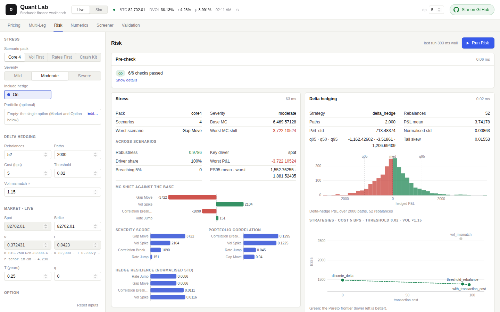
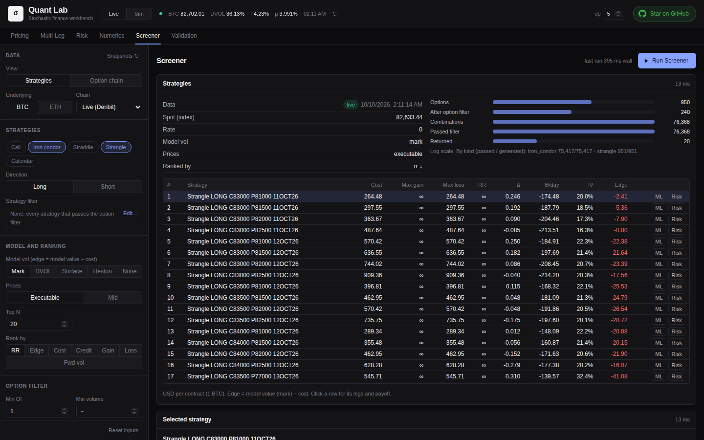
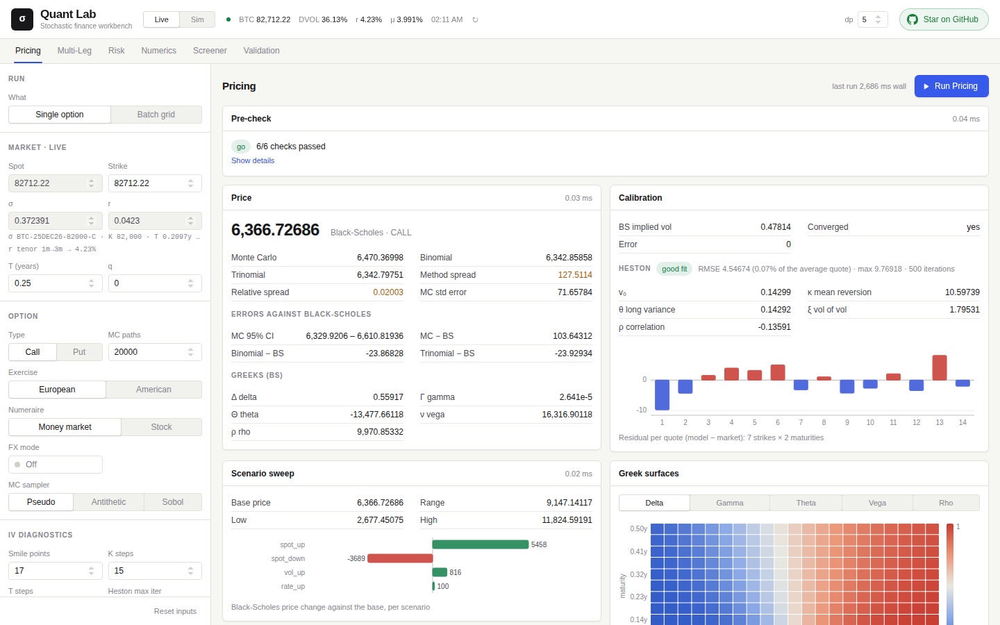

# Research

The research side finds and tests trade ideas before they reach the paper account: pricing, volatility-model calibration, stress tests, hedging comparisons, a screener for option chains, and backtests of a picked idea as a rule. A person uses it through the page's Research tabs; an AI agent calls the same functions (tools) over the server's API. Nothing here places an order.



## The research views

| View | What it does |
|---|---|
| Backtest | runs a strategy over a range of recorded days: summary, cumulative P&L, Greeks carried, each day's result; the same engine as live ([engine.md](engine.md#backtests)) |
| Screener | builds single calls, straddles, strangles, iron condors and calendars from a chain; filters by price, liquidity, spread, days to expiry, moneyness, cost, risk-reward, delta, volatility; ranks by edge (model value minus the cost at quoted prices). Chains: live BTC or ETH from Deribit, or SPXW and SPY at any minute of a recorded day. A pick goes to Multi-Leg or Risk, or is backtested as a rule with and without a hedge |
| Pricing | one option by every method side by side (Black-Scholes, Monte Carlo, binomial and trinomial trees), five Greeks, the differences between methods, IV, a Heston calibration, a scenario sweep, Greek surfaces, the market's smile and term structure; a grid of spot and volatility shocks |
| Multi-Leg | prices any combination of legs, names it (straddle, butterfly, iron condor, ...), sums the Greeks |
| Risk | stress scenarios for an option or a position (crashes, volatility spikes, rate moves, three severities each), each scenario's P&L split by spot, volatility and rate; four delta-hedging schemes compared on the same simulated paths |
| Numerics | finite-difference PDE pricing, tree convergence, every method benchmarked against a reference, the change of measure from real-world to risk-neutral |
| Validation | the numerics against theory: sample moments, Itô's formula on simulated paths, simulation and hedging sanity, trees against closed forms; each failed check with a suggested fix |

- Every view opens with a sample result. Larger inputs (legs, filters, method settings) open in dialogs.
- Every run is kept; the History drawer brings one back or compares two.

| Screener (dark theme) | Pricing |
|---|---|
|  |  |

## Checking the numbers

- **Methods check each other**: a price is shown by several independent methods with their differences. An American option is valued by trees, finite differences and Longstaff-Schwartz, with the early-exercise premium.
- **A validation gate** can run before a computation: it tests the numerics against theory with the current settings and can block a run, naming the setting to change (more paths, finer steps, ...).
- **Warnings** come with each result they affect: a stale or offline chain, wide or crossed quotes, marks outside their quotes, a calibration ending at its bounds, a hedge with no quotes for its instrument.
- **Reproducible**: parallel computations give the same bits whatever the number of threads; every result has a run id to look up, rerun and compare.

## Market data

| Data | From | When it is unavailable |
|---|---|---|
| BTC and ETH spot | Binance | a fixed value |
| BTC implied-volatility index (DVOL) | Deribit | 80% |
| Full BTC and ETH option chains | Deribit | the latest saved snapshot, then a recorded one shipped with the code |
| Funding rate, as an annual drift | Binance futures | a typical value |
| Interest rates, 1 month to 2 years | the US Treasury's daily yield curve | a fixed curve |
| SPXW and SPY option chains | the engine's recorded and backtest days | — |

- No API keys. Each source fails on its own: its fallback is used, the others carry on, and the result names the source used.
- **Treasury curve**: about 18 s to fetch, changes once a day; fetched in the background and kept. A request waits only when no curve is less than a day old.
- **Deribit chains**: converted to USD with each row's own underlying price; each expiry's forward is the median across its rows; Deribit's rate is used so Greeks match the exchange's marks. Cached for a minute; 20 per currency saved for offline use.
- **SPXW and SPY chains**: priced as the engine prices a live snapshot: mids, each expiry's forward from put-call parity, IVs from the engine's Black function. The recorder writes a day each minute.

## The methods

| Area | What is computed |
|---|---|
| Pricing | Black-Scholes in closed form (calls, puts, dividend yield, a currency mode, digital calls). Monte Carlo up to 20 million paths: plain, antithetic, Sobol. Binomial and trinomial trees, European and American. Finite differences (explicit, implicit, Crank-Nicolson; American by PSOR), the time step refined when an explicit scheme would be unstable. Longstaff-Schwartz for American options. Up to 500 options in one call |
| Implied volatility | Jäckel's "Let's Be Rational" on the Black price (`quant/pricing/black.cpp`), the same function in the engine and the tools |
| Calibration | Heston prices from the characteristic function (a form without branch-cut problems); a Heston fit to market prices by bounded Nelder-Mead, graded by its error as a share of the average quote. A smile as raw SVI (`quant/pricing/svi.cpp`): Zeliade's quasi-explicit fit to the out-of-the-money IVs, each residual over its half spread, checked for butterfly arbitrage; the engine fits every chain with it |
| Stress | four scenario packs (Core 4, Vol First, Rates First, Crash Kit), three severities each. Each scenario reprices by three methods, optionally hedges, and splits P&L into spot, volatility and rate; a summary gives a robustness score, the main driver and the worst case. A position is stressed whole, each leg with its own volatility and forward; the live engine's holdings too |
| Hedging | a position (by default one option sold) delta-hedged on simulated paths four ways: fixed steps, with transaction costs, only past a delta threshold, with deltas from the wrong volatility. Each: P&L distribution, VaR and expected shortfall at 95%, turnover, costs; cost against tail risk plotted. On real days, the engine's own hedge is compared instead |
| Screener | strikes against each expiry's forward, Greeks by Black-76, costs at the price you would trade (ask to buy, bid to sell) unless the mid is asked for. Model value from the option's mark, a flat volatility, an IV surface, or a Heston model fitted to the chain. About two million iron condors enumerated in about 12 ms |
| Selection statistics | the deflated Sharpe ratio, the probability of backtest overfitting, walk-forward selection (`quant/stats/selection.cpp`), used by the experiment ledger |
| Features | realized volatility, percentile rank, IV at a delta (`quant/stats/features.cpp`) |
| Theory | normal moments from a seeded sample; Itô's formula on discrete paths (the gap shrinks like the square root of the time step); Brownian and Vasicek paths; the Radon-Nikodym density and real-world against risk-neutral |

## For agents

Every computation is a **tool**: a name, a description written for a language model, inputs with every field explained (with units), and an example. There are 61.

| Call | How |
|---|---|
| list | `GET /api/tools`: every tool with its description and input schema |
| run | `POST /api/tools/<name>` |
| from Python, in the server's environment | `optra.tools.call_sync` |

```bash
curl -s http://127.0.0.1:8080/api/tools/price_option -H 'content-type: application/json' \
  -d '{"spot": 100, "strike": 105, "rate": 0.03, "vol": 0.2, "maturity": 0.5}'
```

```python
from optra.tools import call_sync
r = call_sync("price_option", spot=100, strike=105, rate=0.03, vol=0.2, maturity=0.5)
r["result_summary"]["bs"]
```

- **Every answer has one shape**: `result_summary` (headline numbers), `result_details` (tables and curves), `warnings`, `diagnostics` (how it was computed), the inputs with defaults filled in, and a `run_id`.
- **Input errors** are answered field by field; an unknown field is an error, so a misspelt name is not ignored.
- **Every result is kept** (`~/.optra/runs.db`): a run id can be cited, looked up, rerun and compared.
- **Units**: rates and volatilities are decimals per year (0.05 is 5%), maturities in years, prices in the underlying's units.

**Experiments are written down before they run:**

- A backtest is first a file, `strategy/configs/<name>.json`: the strategy, one setting or a space of them, its hypothesis, the days and the costs, every default written out.
- `put_config` checks it without running it: unknown parameters, values out of range, how many trials it would register, how many its hypothesis has left.
- `backtest` with the config's name runs it; the ledger keeps the name; `research_configs` lists every config with the experiments that ran it.
- Run again unchanged, a config finds its trials in the ledger and counts nothing new.
- The folder belongs to the owner and the agents and is not in git.

**A new idea is a class of its own** in `strategy/research/`: its rules and the features it reads, computed in it as it runs from what the backtest gives (quotes, IVs, smiles, the values by day). The same code then trades it live.

**`ComboStrategy`** runs a combo picked in the lab and sweeps a structure; it gets no new filters. Its parameters:

| Parameter group | What it sets |
|---|---|
| `leg1`–`leg4`: `ratio`, `right`, `strike_pct`, `dte` | up to four legs: how many (sign = side), call or put, strike as a percent from the forward, days to expiry |
| `entry_minute`, `exit_minute`, `hold` | open and close minutes, or hold to expiry |
| `take_profit`, `stop_loss` | exits as multiples of the premium |
| `close_itm_only` | at the exit, close only the legs in the money and let the rest expire |
| `exact_dte` | no trade on a day without exactly that expiry |
| `prev_rv_min/max`, `move_min/max` | enter only when the day before's realized volatility and the move since the open are within bounds |
| `hedge`, `hedge_timer`, `delta_range` | the engine's delta hedge |
| `model`, `min_edge` | enter only on a Heston edge |

The agent tasks in `app/server/tests/evals` have checkable answers. `tests/evals/run.py` gives them to Claude with the tools; when a task fails, the fix is a better tool description or error message, not a different task.

## How it is built

| Layer | Does | Does not |
|---|---|---|
| The C++ numerical library (`engine/quant`) | every computation | network, files |
| The server (`app/server`) | fetches market data, checks inputs, calls the library through its C interface (in a pool of two processes), adds warnings, keeps the history | arithmetic of its own |
| The page (`app/web`) | shows inputs and results | computation |

- A new capability goes up the stack: numerical routine → workflow → result structure → C entry point → Python wrapper → tool with described inputs → view.
- The library and the server share a version number for the shape of their answers; a library built for another version is refused with a message that the engine needs rebuilding.

## Tests and verification

- From `app/server`, `uv run --group dev pytest -q tests/tools` runs the research tests offline in about a minute: pricing, hedging, theory checks, the screener and its routes, option chains and their fallbacks, every tool's description and example, the run history, the agent evals.
- A live check against Deribit runs with `OPTRA_DERIBIT_LIVE=1`; a comparison with the QF-205 course package runs when that package is available.

Results recorded when the methods were added:

| Check | Result |
|---|---|
| Trees against QF-205 | agree to 2e-13 |
| Finite differences against QF-205 | agree to 1e-14; the one larger difference, American PSOR, is a QF-205 bug (a boundary term counted twice) |
| Trinomial tree convergence | order −1 |
| Longstaff-Schwartz, 100,000 paths | within 1% of a 2,000-step tree |
| American PDE | within 0.5% of the tree |
| The ported screener | matched the original row for row, apart from the defects fixed |

## Where the code came from

| Source | What came from it |
|---|---|
| an option screener in C++ | filters, generators and strategies; defects fixed: wrong maximum gain and loss for iron condors, direction ignored, filters rewriting shared data |
| the QF-205 course's Python code | the trinomial tree, the finite-difference schemes |
| an option-pricing project in C++ | Longstaff-Schwartz; the queues and thread pool, now used only in the concurrency benchmark |

The research side started as a companion to a nine-session course on risk-neutral pricing; every topic of that course, from Brownian motion and Itô calculus to Girsanov's theorem and dynamic hedging, has a tool.
